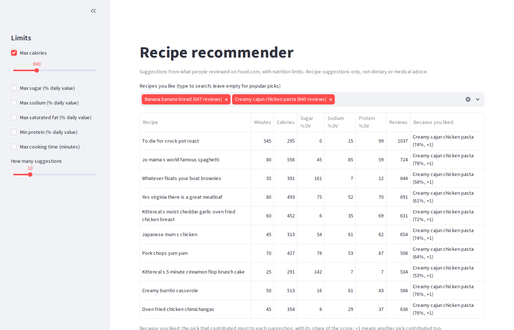

# recipe-recommender

Recommends recipes from what people reviewed on Food.com, with nutrition limits applied after
ranking. Four models (popularity, item-kNN, PureSVD and BPR matrix factorisation in TensorFlow)
are compared under a time-based split, full-catalogue ranking and bootstrap confidence intervals.

**Recipe suggestions only, not dietary or medical advice.**



## Results

Test set: the newest 20% of each user's reviews. Settings were chosen on a separate validation
slice, and test was scored once with them. The table is generated from `runs/` by
`reciperec.report`; full detail, including slices, is in [docs/results.md](docs/results.md).

<!-- results:start -->
| Dataset | Model | NDCG@10 | vs popularity [95% CI] | Coverage@10 |
|---|---|---:|---:|---:|
| Food.com | Popularity | 0.0148 |  | 0.1% |
| Food.com | Item-kNN | 0.0160 | +8% [+2%, +15%] | 34.9% |
| Food.com | PureSVD | 0.0149 | +0% [-5%, +7%] | 4.6% |
| Food.com | BPR-MF | 0.0156 | +5% [+1%, +10%] | 4.0% |
| MovieLens 1M | Popularity | 0.1095 |  | 3.2% |
| MovieLens 1M | Item-kNN | 0.1432 | +31% [+26%, +35%] | 13.0% |
| MovieLens 1M | PureSVD | 0.1312 | +20% [+15%, +25%] | 24.8% |
| MovieLens 1M | BPR-MF | 0.1375 | +26% [+22%, +29%] | 29.5% |
<!-- results:end -->

**What this shows**

- **On Food.com, personalisation beats popularity by a small but real margin.** Item-kNN and BPR
  are ahead with 95% intervals above zero; PureSVD is not distinguishable from popularity.
  Absolute scores are low because the catalogue is large (41k recipes), most users have few
  reviews, and every model ranks the whole catalogue.
- **On MovieLens 1M, every model beats popularity by a wide margin.** MovieLens is here only to
  check the evaluation code on a well-known dataset; the ordering is as expected.
- **Popular recipes dominate.** Most suggestions from popularity, PureSVD and BPR come from the
  top 1% of recipes; item-kNN adds the most variety (by far the highest coverage).
- **Heavier users get better suggestions** from every model (activity table in
  [docs/results.md](docs/results.md)).
- **BPR won on validation, item-kNN on test.** The choice made on validation was kept; changing it
  after seeing test would leak the test set into the decision.
- **Tried and rejected:** item-kNN without shrinkage (it favoured obscure recipes), and
  down-weighting very heavy reviewers (made results worse on validation).

## Run it

Needs [uv](https://docs.astral.sh/uv/) and Python 3.12.

```bash
uv sync
uv run pytest                                            # tests use small synthetic data
uv run python -m reciperec.profile                       # data profile -> docs/data.md
uv run python -m reciperec.tune --dataset foodcom        # grid search on validation (~1 h)
uv run python -m reciperec.evaluate --dataset foodcom \
  --model popularity itemknn puresvd bpr --tuned         # one test run with the chosen settings
uv run python -m reciperec.report                        # docs/results.md and the table above
uv run streamlit run app.py                              # local demo at http://localhost:8501
```

`./reproduce.sh` runs the whole pipeline for both datasets (about 1 to 1.5 hours on a laptop CPU).

Command-line suggestions without the demo:

```bash
uv run python -m reciperec.recommend --search "banana bread"
uv run python -m reciperec.recommend --like 25885 39087 --max-calories 600
uv run python -m reciperec.recommend --min-protein-pdv 40 --max-minutes 30   # no picks: popular
```

## Data

Neither dataset is committed: their licences do not allow redistribution, so the demo runs
locally only.

- **Food.com** (Majumder et al., 2019): only `RAW_interactions.csv` and `RAW_recipes.csv` from
  Kaggle's `shuyangli94/food-com-recipes-and-user-interactions` are needed, in `data/foodcom/`:

  ```bash
  mkdir -p data/foodcom && cd data/foodcom
  for f in RAW_interactions.csv RAW_recipes.csv; do
    kaggle datasets download shuyangli94/food-com-recipes-and-user-interactions -f "$f" --unzip
  done
  ```

  1.13M reviews of 231k recipes by 227k users, 2000 to 2018. Profile in
  [docs/data.md](docs/data.md).
- **MovieLens 1M** (Harper and Konstan, 2015): downloaded automatically.

Screenshots show a handful of recipe names and nutrition values for illustration.

## Method

- **Implicit feedback.** 76% of Food.com reviews with stars give 5, so the rating says little. A
  review counts as "interested"; the stars are dropped.
- **5-core.** Users and recipes with fewer than 5 reviews are removed, repeatedly, because nothing
  can be learned about them. This keeps about half the reviews and 8% of users (most users wrote
  one review).
- **Time-based split.** Each user's history, oldest first: about 64% train, 16% validation, 20%
  test. A random split would let models learn from the future.
- **Full-catalogue ranking.** Every model scores every recipe; recipes already in the user's
  training history are removed; the top 10 are scored. No sampled negatives, which inflate scores
  (Krichene and Rendle, 2020).
- **Metrics at 10.** Precision, recall, NDCG (rewards hits near the top) and catalogue coverage
  (share of recipes that appear in anyone's top 10).
- **Tuning.** A small grid per model on validation; BPR uses early stopping on validation and the
  test run trains for the best epoch count.
- **Confidence intervals.** Gain over popularity with a 95% paired bootstrap over test users
  (2,000 resamples).

## Models

| Model | Idea | Code |
|---|---|---|
| Popularity | Most-reviewed recipes for everyone; the baseline | `reciperec/models/popularity.py` |
| Item-kNN | Recipes reviewed by the same people are similar (cosine with shrinkage, top-N neighbours) | `reciperec/models/itemknn.py` |
| PureSVD | Truncated SVD of the user x recipe matrix (scikit-learn) | `reciperec/models/puresvd.py` |
| BPR-MF | User and recipe embeddings trained so reviewed recipes outrank random ones (TensorFlow) | `reciperec/models/bpr.py` |

**Nutrition limits** (`reciperec/nutrition.py`) remove recipes after ranking, so they never change
the order of what is left. **Cold start** (`reciperec/recommend.py`): a new visitor picks a few
recipes and item-kNN scores everything by similarity to them, with no retraining; with no picks
they get popular recipes within their limits. **Explanations:** each suggestion names the pick
that contributed most to its score and that pick's share, so a near even split is shown, not
hidden.

## Limitations

- Serves only users and recipes in the 5-core; a review is not proof someone cooked or liked a
  recipe; the data ends in 2018.
- Nutrition values are as entered on Food.com and are not checked; some are clearly wrong (one
  recipe lists over 400,000 calories). Upper limits remove those, but the values should not be
  trusted for health decisions.
- One time-based split and one seed per model; intervals cover user sampling, not training noise.
- No content features (ingredients, tags, text); BPR samples negatives uniformly.
- Laptop scale: 7 GB RAM, CPU only.

## Model card

- **Intended use:** suggesting recipes to try, with optional nutrition and time limits; a learning
  and portfolio project.
- **Not for:** dietary, medical or allergy decisions. Limits filter on unverified user-entered
  values.
- **Training data:** Food.com reviews 2000 to 2018, 5-core. Reviewers are not a representative
  sample of cooks; English-language recipes from one site.
- **Evaluation:** time-based holdout, full-catalogue ranking, NDCG@10 with 95% bootstrap
  intervals against popularity; results above.
- **Known biases:** strong popularity bias (most suggestions come from the top 1% of recipes);
  light users get weaker suggestions than heavy users.

## Layout

```
reciperec/   data, split, metrics, models/, tune, evaluate, slices, report,
             nutrition, recommend, profile
tests/       unit tests on small synthetic matrices (run in CI)
app.py       Streamlit demo
docs/        data.md, results.md (generated), img/
```

## References

- Majumder, Li, Ni and McAuley (2019). Generating Personalized Recipes from Historical User
  Preferences. EMNLP-IJCNLP.
- Harper and Konstan (2015). The MovieLens Datasets: History and Context. ACM TiiS.
- Sarwar, Karypis, Konstan and Riedl (2001). Item-Based Collaborative Filtering Recommendation
  Algorithms. WWW.
- Rendle, Freudenthaler, Gantner and Schmidt-Thieme (2009). BPR: Bayesian Personalized Ranking
  from Implicit Feedback. UAI.
- Cremonesi, Koren and Turrin (2010). Performance of Recommender Algorithms on Top-N
  Recommendation Tasks. RecSys.
- Ferrari Dacrema, Cremonesi and Jannach (2019). Are We Really Making Much Progress? A Worrying
  Analysis of Recent Neural Recommendation Approaches. RecSys.
- Krichene and Rendle (2020). On Sampled Metrics for Item Recommendation. KDD.
- Breese, Heckerman and Kadie (1998). Empirical Analysis of Predictive Algorithms for
  Collaborative Filtering. UAI.

## Licence

Code: MIT (see `LICENSE`). Data: not included; see each dataset's own terms.
